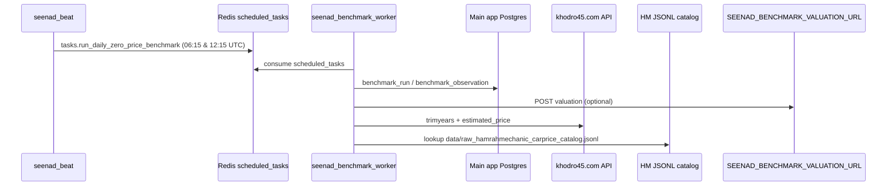

# Zero Price Benchmark Scraper — Production Audit

**Repository:** `erfanhpcar/seenad-scraper`  
**Audit branch:** `audit/zero-price-benchmark-scraper`  
**Base commit (master):** `5f11e356f555bdf1b585d34df42781c9b26ee9b5`  
**Audit date:** 2026-10-20 (Asia/Tehran)  
**Scope:** Read-only code + operational inspection on the scraper host. No migrations, restarts, or data changes were performed.

---

## Executive summary

The zero-price benchmark pipeline is **architecturally wired** (Celery Beat → `scheduled_tasks` → `benchmark_worker` → main-app Postgres), but on the inspected production scraper node it is **not operational end-to-end**:

1. **`seenad_benchmark_worker` is not running**; the default `seenad_worker` only consumes the `celery` queue, while benchmark tasks are routed to `scheduled_tasks` (Redis queue depth **5** unprocessed messages).
2. **`secrets/benchmark_database_url` is missing**, so `ensure_benchmark_worker.sh` exits without starting the worker, and `run_benchmark_pipeline.sh` cannot target the main-app database.
3. **Local scraper Postgres has zero `benchmark_*` tables** — benchmark data is intended for the main SeenAd database, not the scraper `db` service.
4. **Khodro45 price parsing is broken** against the current API response shape (`market_price` is a nested object); mapped K45 rows raise `TypeError` and would **abort the entire Celery task** before `benchmark_run` is finalized.
5. **Hamrah Mechanic catalog mode works** when automap finds a row (~54% of watchlist in offline simulation); ~46% remain unmapped with the scraper-side fuzzy automap.

**Verdict:** `SCRAPER_REQUIRES_FIX`

---

## A — Code architecture (as implemented)

### Flow



### Entry points and dependencies

| Component | Role |
|-----------|------|
| `app/celery_app.py` | Beat schedule `run-zero-price-benchmark-0945-1545-tehran`; task route to queue `scheduled_tasks` |
| `app/tasks/zero_price_benchmark.py` | Celery task; gated by `BENCHMARK_ENABLED` |
| `src/zero_price_benchmark/runner.py` | Core loop: load cars → per-source fetch → insert observations |
| `src/zero_price_benchmark/automap.py` | Best-effort mapping into `benchmark_source_mapping` |
| `src/zero_price_benchmark/k45_prices.py` | K45 HTTP client |
| `src/zero_price_benchmark/hm_prices.py` | HM catalog index + lookup |
| `src/zero_price_benchmark/seenad_prices.py` | HTTP to main app or optional local module |
| `src/scraper/hamrah_mechanic_carprice_service.py` | Builds/refreshes HM JSONL |
| `src/scraper/khodro45_pricing_service.py` | K45 dailycars API (automap source) |
| `scripts/run_benchmark_pipeline.sh` | Manual pipeline (preflight, worker, automap, run) |
| `scripts/check_benchmark_db.py` | Connectivity + table smoke test |
| `scripts/import_zero_price_benchmark_watchlist.py` | Excel → `benchmark_car` |
| `scripts/auto_map_zero_price_benchmark.py` | CLI wrapper for `run_automap` |
| `scripts/ensure_benchmark_worker.sh` | Starts `benchmark_worker` only if secret file exists |

### Scraper SQL contract (raw SQL in code)

The scraper does **not** define SQLAlchemy models for benchmark tables (`app/models.py` has no benchmark entities). It assumes the following columns exist on the **main application** database:

| Table | Columns used by scraper |
|-------|-------------------------|
| `benchmark_car` | `id`, `seenad_car_id`, `is_active`, `priority`, `mapping_status` |
| `benchmark_source_mapping` | `benchmark_car_id`, `source`, `status`, `external_payload` (+ `ON CONFLICT (benchmark_car_id, source)`) |
| `benchmark_run` | `status`, `expected_count`, `processed_count`, `started_at`, `finished_at`, `trigger` |
| `benchmark_observation` | `run_id`, `benchmark_car_id`, `source`, `status`, `price_irr`, `error_message`, `raw_payload`, `fetched_at` |
| `car` (automap only) | `id`, `brand`, `model`, `trim` joined via `seenad_car_id` |

Observation `status` values written: `OK`, `SOURCE_ERROR`, `NEEDS_MAPPING`.

**Alembic in this repo:** No migrations create `benchmark_*` tables (`alembic/versions/` unrelated; `postgres/migrations/` has no benchmark DDL). Schema lifecycle is owned by the **main SeenAd application database**.

---

## B — Database contract and connectivity

### Which database?

| Consumer | Intended DB | How URL is resolved |
|----------|-------------|---------------------|
| `seenad_backend`, `seenad_worker`, `seenad_beat` | Scraper Postgres (`db:5432`) | `DATABASE_URL` + `POSTGRES_HOST=db` → component URL wins over string URL (`app/database.py` L27–39) |
| `seenad_benchmark_worker` | Main app Postgres | `DATABASE_URL=${BENCHMARK_DATABASE_URL}` in compose |
| `scripts/check_benchmark_db.py`, pipeline scripts | Main app | `secrets/benchmark_database_url` or `BENCHMARK_DATABASE_URL` passed as `DATABASE_URL` |

### `POSTGRES_HOST` vs `DATABASE_URL` (definite bug for `benchmark_worker`)

`app/database.py` `_build_engine_url()`:

```27:41:app/database.py
def _build_engine_url() -> str | URL:
    if settings.postgres_host != "localhost" or settings.postgres_port != 5432:
        return URL.create(
            drivername="postgresql+psycopg2",
            username=settings.postgres_user,
            password=settings.postgres_password,
            host=settings.postgres_host,
            port=settings.postgres_port,
            database=settings.postgres_db,
        )
    if settings.database_url:
        return settings.database_url
```

`benchmark_worker` sets `DATABASE_URL` from `BENCHMARK_DATABASE_URL` but **inherits `POSTGRES_HOST=db` from `.env`** (not overridden in `docker-compose.yml` L160–166). In that configuration, **`BENCHMARK_DATABASE_URL` is ignored** and the worker would connect to scraper `seenad_db`, which has **no benchmark tables**.

Reproduced via settings simulation on the backend container: with `POSTGRES_HOST=db`, engine host resolves to `db` even when `DATABASE_URL` points at a remote main-app host.

### Cross-repo schema alignment

**Auditor note:** The main SeenAd repository (`seenad-main`) was **not accessible** from this environment (private Git). The audit brief states main-app ORM models may use **different column names** than the scraper’s raw SQL.

| Scraper expects (code) | Risk if main DB differs |
|------------------------|-------------------------|
| `benchmark_car.is_active` | Inserts/filters fail if column is e.g. `active` |
| `benchmark_source_mapping.external_payload` | Mapping load returns null → `NEEDS_MAPPING` / errors |
| `benchmark_source_mapping.status` | Automap upsert failures |
| `benchmark_observation.price_irr` | Admin shows null if app reads another column |
| `benchmark_observation.raw_payload` | Loss of debug payload in admin |
| `benchmark_run.trigger` | Insert may fail on NOT NULL / missing column |

**Status:** `NOT_VERIFIED_ON_PRODUCTION` for main-app `information_schema` (no `secrets/benchmark_database_url` on host; read-only main DB introspection not performed).

### Scraper local DB (verified on host)

```sql
-- information_schema on seenad_db container: 0 rows matching benchmark%
```

---

## C — Twice-daily scheduling and workers

### Expected schedule (Asia/Tehran)

| Local (Tehran) | UTC (Beat `crontab`) | Env override |
|----------------|----------------------|--------------|
| 09:45 | 06:15 | `ZERO_PRICE_BENCHMARK_BEAT_HOURS_UTC=6,12`, minute `15` |
| 15:45 | 12:15 | same |

Configured in `docker-compose.yml` L228–230 and `app/celery_app.py` L295–315.

### Beat behavior (verified, last 48h)

Beat **does** enqueue the task:

```
Scheduler: Sending due task run-zero-price-benchmark-0945-1545-tehran (tasks.run_daily_zero_price_benchmark)
```

Observed at **2026-10-18/19/20 06:15 UTC** and **12:15 UTC** (4 firings in 48h).

### Worker consumption (verified — failing)

| Service | Queue(s) | `BENCHMARK_ENABLED` | Running on host |
|---------|----------|---------------------|-----------------|
| `seenad_worker` | `celery` only | not set (defaults off in task) | Yes |
| `seenad_benchmark_worker` | `scheduled_tasks` | `1` in compose | **No** |

`celery inspect active_queues` on `seenad_worker`: only queue name `celery`.

Redis: `LLEN scheduled_tasks` = **5** (tasks include `tasks.run_daily_zero_price_benchmark`).

**Last successful `tasks.run_daily_zero_price_benchmark` in worker logs (72h):** none found.

**Concurrent runs:** No consumer → no parallel execution; tasks accumulate in Redis (no deduplication).

### Active cars / processed counts

**`NOT_VERIFIED_ON_PRODUCTION`** on main DB (`benchmark_run`, `benchmark_car` counts). Offline watchlist Excel contains **50** cars (`tmp/SeenAd_Top_50_Setoudeh_Priority (1).xlsx`).

### Error handling vs commit

`runner.py` commits every 25 cars (L241–245) and once at end (L245–246). An uncaught exception (e.g. K45 `TypeError`) leaves:

- `benchmark_run.status = 'running'` (no `_finish_run`)
- Uncommitted observations if failure before next batch commit

---

## D — Extraction quality by source

### Khodro45 (`k45_prices.py`)

| Check | Result |
|-------|--------|
| Endpoints | `GET /api/v1/trimyears/`, `POST /api/v1/carprice/public/estimated_price/` |
| HTTP | `estimated_price` returns **200** in smoke test |
| Response shape | **Changed:** body has `market_price` / `k45_price` objects, not scalar `price` |
| Parser | L74–76 uses `data.get("market_price")` as price; when dict, L86 `int(price)` → **TypeError** |
| trimyear resolution | Works when `trim_id` + `year_id` present in mapping |
| Currency | Values are IRR-scale integers inside nested `.price` |
| Timeout | 45s per request |

**Offline watchlist simulation (50 cars, scraper automap rules, no DB):**

| Outcome | Count |
|---------|------:|
| `NEEDS_MAPPING` (no K45 match) | 19 |
| Would **abort task** (`TypeError` on mapped rows) | 31 |
| `OK` | 0 |

### Hamrah Mechanic (`hm_prices.py` + catalog)

| Check | Result |
|-------|--------|
| Data source | `data/raw_hamrahmechanic_carprice_catalog.jsonl` |
| File freshness | **2026-10-20 06:35 UTC**, 885 rows, all rows have `market_price` |
| Lookup key | `(car_type_id, car_year)` |
| Stale catalog | Prices only as fresh as last crawl (same day as IranJib beat window) |
| Catalog failure | `load_catalog_index()` may invoke full HM pipeline (slow, network-dependent) |

**Offline watchlist simulation:**

| Outcome | Count |
|---------|------:|
| `OK` | 27 |
| `NEEDS_MAPPING` | 23 |
| `SOURCE_ERROR` | 0 |

### SeenAd (`seenad_prices.py`)

| Check | Result |
|-------|--------|
| Local module `seenad_valuation_local` | **Not present** in repo |
| `SEENAD_BENCHMARK_VALUATION_URL` | **Not set** on `seenad_worker` / `seenad_beat` env inspection |
| Expected behavior | `SOURCE_ERROR` with message about missing URL |

---

## E — Sample watchlist rows (offline, no DB IDs)

`benchmark_car_id` is **unknown** without main DB (`NOT_VERIFIED_ON_PRODUCTION`).  
`fetched_at` omitted (no observation rows written).  
Currency: **IRR** where price present.

| seenad_car_id | benchmark_car_id | source | mapping | expected_year | actual_year | price (IRR) | status | error_code |
|--------------:|-----------------:|--------|---------|---------------|-------------|------------:|--------|------------|
| 103 | — | HAMRAH_MECHANIC | missing | — | — | null | NEEDS_MAPPING | no_automap_match |
| 103 | — | KHODRO45 | missing | — | — | null | NEEDS_MAPPING | no_automap_match |
| 111 | — | HAMRAH_MECHANIC | present | — | 1405 | 3,850,000,000 | OK | — |
| 111 | — | KHODRO45 | present | — | 1404 | null | TASK_ABORT | TypeError: int(dict) on price |
| 121 | — | HAMRAH_MECHANIC | present | — | 1405 | 6,270,000,000 | OK | — |
| 121 | — | KHODRO45 | present | — | 1405 | null | TASK_ABORT | TypeError on nested `market_price` |
| 1213 | — | HAMRAH_MECHANIC | present | — | 1404 | 4,900,000,000 | OK | — |
| 1213 | — | KHODRO45 | present | — | 1404 | null | TASK_ABORT | TypeError |
| 1210 | — | HAMRAH_MECHANIC | present | — | 1405 | 6,100,000,000 | OK | — |
| 1210 | — | KHODRO45 | present | — | 2026 | null | TASK_ABORT | TypeError |

Additional samples with **HM OK + K45 mapping missing:** 115, 120, 110 (HM and K45 both `NEEDS_MAPPING`).

---

## Definite issues (with location)

| ID | Severity | Issue | Location |
|----|----------|-------|----------|
| D1 | P0 | Benchmark tasks enqueued to `scheduled_tasks` but **no running consumer** | `docker-compose.yml` L127–169; host: `seenad_benchmark_worker` absent; Redis `scheduled_tasks` depth 5 |
| D2 | P0 | `benchmark_worker` likely connects to **wrong DB** when `POSTGRES_HOST=db` (ignores `BENCHMARK_DATABASE_URL`) | `app/database.py` L27–39; `docker-compose.yml` L160–166 |
| D3 | P0 | K45 parser treats `market_price` dict as scalar → **task crash** | `src/zero_price_benchmark/k45_prices.py` L74–86 |
| D4 | P1 | No `secrets/benchmark_database_url` → worker never auto-started | `scripts/ensure_benchmark_worker.sh` L7–8 |
| D5 | P1 | Scraper DB has no benchmark schema; misconfiguration writes nowhere useful | Verified `information_schema` on `seenad_db` |
| D6 | P2 | `seenad_prices` cannot run without main-app valuation URL | `src/zero_price_benchmark/seenad_prices.py` L32–38 |
| D7 | P2 | Scraper-side automap substring matching misses ~46% HM / ~38% K45 on watchlist | `src/zero_price_benchmark/automap.py` L106–137 |

---

## Probable issues and how to prove

| Hypothesis | Proof steps |
|------------|-------------|
| Admin nulls because observations never land in main DB | Read-only: `SELECT count(*), max(started_at) FROM benchmark_run` on main DB |
| Main ORM reads different column than `price_irr` | Compare Alembic/models in seenad-main vs scraper SQL; `SELECT column_name FROM information_schema.columns WHERE table_name='benchmark_observation'` |
| Partial runs stuck in `running` | `SELECT id, status, started_at FROM benchmark_run WHERE status='running'` |
| HM prices stale vs dashboard | Compare `fetched_at` max per source with catalog file mtime |
| Beat enabled but feature flag off on worker | `docker exec seenad_benchmark_worker printenv BENCHMARK_ENABLED` (when running) |

---

## Root cause analysis (admin null prices)

1. **Primary (operations):** Scheduled benchmark jobs are **not executed** — Beat fires, Redis queues tasks, **`benchmark_worker` is down** and default worker does not subscribe to `scheduled_tasks`.
2. **Primary (code, when worker runs):** Even with mappings, **K45 extraction throws** on current API JSON, aborting the run and preventing reliable `benchmark_observation` rows for K45 (and potentially blocking later cars in the same task).
3. **Secondary:** Without main-app DB URL/secret, pipeline scripts and worker provisioning never target the database the **admin dashboard** reads.
4. **Secondary:** HM and automap gaps yield `NEEDS_MAPPING` / null `price_irr` for many watchlist cars even when the pipeline runs.
5. **Unverified:** ORM/admin layer in main app may expect different column names than scraper writes (`NOT_VERIFIED_ON_PRODUCTION`).

---

## Remediation plan (priority)

### P0

1. Fix `k45_prices.py` to read nested `market_price.price` / `k45_price.price` (and never `int()` a dict); wrap per-car errors so one failure does not abort the run.
2. Fix `_build_engine_url()` for benchmark worker: honor `DATABASE_URL` when set, or set `POSTGRES_HOST=localhost` on `benchmark_worker` only, or use a dedicated `create_engine(os.environ["DATABASE_URL"])` in the benchmark task.
3. Provision `secrets/benchmark_database_url` (deployment secret, not in git) and start `benchmark_worker` (`docker compose --profile benchmark up -d benchmark_worker`).
4. Drain or purge stale Redis `scheduled_tasks` messages after worker is healthy (operational step during cutover).

### P1

5. Confirm main DB schema matches scraper SQL; align via migration in **main app** or adjust scraper SQL to match production columns.
6. Set `SEENAD_BENCHMARK_VALUATION_URL` (or ship supported local valuation adapter) for SEENAD source rows.
7. Improve mapping coverage (main-app fuzzy automap per `automap.py` docstring) — scraper automap is intentionally conservative.

### P2

8. Add observability: alert on `scheduled_tasks` depth, `benchmark_run` stuck `running`, observation error rates.
9. Document runbook linking `scripts/run_benchmark_pipeline.sh` to secret + worker profile.

---

## Zero-downtime rollout

1. Deploy code fixes (K45 parser + DB URL resolution + defensive error handling) to scraper image/volume **without** restarting main app.
2. Add `secrets/benchmark_database_url` on scraper host; validate with `scripts/check_benchmark_db.py` (read-only counts).
3. Start `benchmark_worker` alongside existing `worker`/`beat` (new container only).
4. Optionally trigger one manual `celery call` via pipeline `run` step during low traffic.
5. Verify admin dashboard after `benchmark_run` completes (read-only SQL).
6. No main DB migration required if schema already matches; if not, migrate main app first in a separate release.

---

## Test, rollback, validation

| Phase | Action |
|-------|--------|
| Test | Unit tests for K45 JSON fixtures (nested price objects); integration test with `BENCHMARK_DAILY_LIMIT=3` against staging main DB |
| Validate | `benchmark_run.processed_count = active cars`; per-source counts of `OK` / `NEEDS_MAPPING` / `SOURCE_ERROR`; admin non-null prices for known-good cars |
| Rollback | Stop `benchmark_worker`; disable `ZERO_PRICE_BENCHMARK_BEAT_ENABLED=0` on beat; redeploy previous image if needed — no DB rollback required for observations (append-only) |

---

## Git vs deployed code on scraper host

| Item | Value |
|------|-------|
| Host path | `/var/www/seenad-scraper` (bind-mounted to `/app`) |
| Git `HEAD` | `5f11e356f555bdf1b585d34df42781c9b26ee9b5` (= `origin/master` at audit time) |
| `seenad_beat` | Recreated ~2 days before audit (aligns with recent benchmark beat commit) |

Code on disk matches **master**; operational gaps are **configuration/runtime**, not an old branch.

---

## Verdict

**`SCRAPER_REQUIRES_FIX`**

The scraper repository contains a coherent benchmark design, but production on the inspected node is missing the benchmark worker and main DB secret, routes DB connections incorrectly when `POSTGRES_HOST` is set, and ships a Khodro45 price parser incompatible with the live API — together sufficient to explain widespread **null** benchmark prices in admin.
